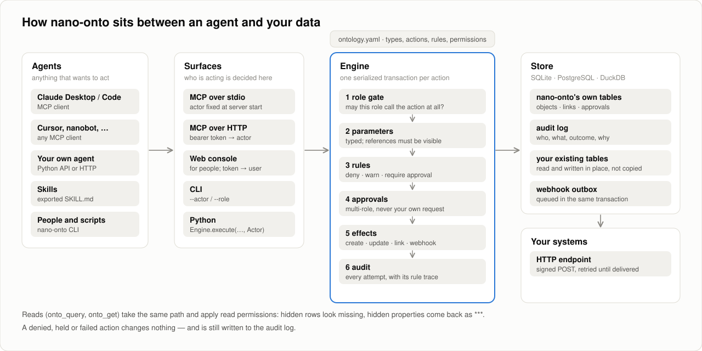

# Architecture

  <picture>
    <source media="(prefers-color-scheme: dark)" srcset="../images/architecture-dark.svg">
    
  </picture>

nano-onto is one engine behind several thin surfaces. An ontology file says what exists and what may happen; the engine enforces it; a SQL store holds the data, the approval requests and the audit log.

## What one action does

`Engine.execute(action, params, actor)` runs these steps inside **one serialized transaction**:

1. **Version check.** The database must follow the ontology this process holds, or the call fails with `VersionError`.
2. **Role gate.** The actor's role must be declared, and be in the action's `allowed_roles` if it has any. Otherwise → `denied`.
3. **Parameters.** Unknown parameters are refused, values are coerced to their types, and object references are resolved -- only to objects the actor may read. Otherwise → `invalid`.
4. **Rules.** Every rule is evaluated over `params` and `actor`. Any `deny` → `denied`. Otherwise any `require_approval` for a role the actor does not hold → `pending_approval`: an approval request is stored and nothing else changes.
5. **Effects.** With no deny and no pending approval, the effects run in order. Any failure -- a missing object, a value that does not fit, a database constraint -- rolls everything back → `invalid`.
6. **Audit.** One row: who, which action, the outcome, the parameters and messages, and the ontology version. It commits with the effects, so an executed action always has its audit row; a rolled-back action gets its row written right after.

`explain` is the same path with `dry_run=True`: no effects, no approval request, but still an audit row.

**Approval.** `approve(request, approver)` checks that the request is pending, that the approver's role is one it still waits for, and that the approver is not the requester. It records the approval; if roles remain, that is all. On the last one it runs steps 2-6 again *as the original requester*, against current data, with the given approvals counted. The request then becomes `executed`, `denied`, stays pending for a newly required role, or -- if the action can no longer run at all -- `failed`. A transient database error changes nothing and can be retried.

**Reads.** `query` and `get` apply `readable_by` and `visible_when` for the given actor; `actor=None` is the trusted view used by the engine itself and by operators.

## What is guaranteed

- A rule is checked by code on every path to a change. There is no tool, command or API that applies an action's effects without evaluating its rules.
- The state the rules saw is the state the effects change: writers are serialized (`BEGIN IMMEDIATE` on SQLite, an advisory lock on PostgreSQL).
- An action either fully happens or does not happen at all, and either way it is in the audit log.
- A requester can never approve their own request; an approval by a role the request does not wait for is refused; both refusals are audited.
- A webhook delivery exists exactly when its action committed.
- A changed ontology is not enforced until it has been migrated, and an old one is not enforced after.

## What is not

- **Identity is given, not verified.** nano-onto trusts whoever starts the stdio server, the holder of an HTTP token, or the CLI caller to say who the actor is. Authenticate users in front of it.
- **Rule outcomes are visible to the actor.** A rule over a masked property reveals one fact per attempt (the attempt is audited). Do not put a secret behind a comparison the user can drive.
- **The audit log is a table, not a ledger.** Anyone with direct write access to the database can alter it.
- **Policy gaps are yours.** nano-onto enforces the rules you wrote. If nothing forbids splitting one large order into ten small ones, it is allowed.

## Modules

| Module | Lines | Role |
|---|---:|---|
| `schema.py` | ~700 | YAML → dataclasses, strict load-time validation, type coercion |
| `expr.py` | ~250 | The expression language: `ast` parse, whitelist, interpreter |
| `engine.py` | ~530 | Actions, approvals, read permissions, version check |
| `store.py` | ~340 | Portable SQL store: objects, links, approvals, audit, outbox, stamp |
| `mcp_server.py` | ~240 | MCP tools and the stdio transport |
| `compile.py` | ~140 | Tool descriptions, JSON Schemas, `SKILL.md` |
| `cli.py` | ~300 | The `nano-onto` command |
| `tables.py` *(optional)* | ~175 | Read-through to existing tables |
| `migrate.py` *(optional)* | ~220 | Schema diff and data migration |
| `webhooks.py` *(optional)* | ~155 | Outbox delivery, retries, signing |
| `http_server.py` *(optional)* | ~145 | MCP over HTTP with bearer tokens |

`bash core_lines.sh` prints the exact counts. Optional modules are imported only when used.

## Storage

All of nano-onto's tables are prefixed `onto_`, so they can share a database with yours:

| Table | Holds |
|---|---|
| `onto_objects` | Objects of unmapped types, as JSON properties keyed by `(type, pk)` |
| `onto_links` | Links of unmapped link types, `(link, from_pk, to_pk)` |
| `onto_approvals` | Approval requests: action, parameters, requester, required and given approvals, status |
| `onto_audit` | The audit log |
| `onto_outbox` | Webhook deliveries and their retry state |
| `onto_meta`, `onto_history` | The ontology stamp and every version the database has followed |
| `onto_counters` | Id and sequence counters |

The same code runs on SQLite, PostgreSQL and DuckDB because it only uses portable SQL; the test suite runs every scenario on all three.

## Limits worth knowing

- **Write concurrency.** One action at a time per database on PostgreSQL (advisory lock), one writer at a time on SQLite, a single process on DuckDB. Right for agent workloads, wrong for a high-throughput OLTP path.
- **Row filters run in Python.** `visible_when` is evaluated after fetching a type's rows, not pushed down to SQL. Exact-match filters on mapped tables *are* pushed down.
- **Read-through** needs single-column primary keys and plain-identifier names.
- **HTTP transport** has static bearer tokens and no event stream: no OAuth, no server-initiated messages.
- **Queries are exact-match.** There is no query language beyond `where` equality filters; use your database for analytics.
