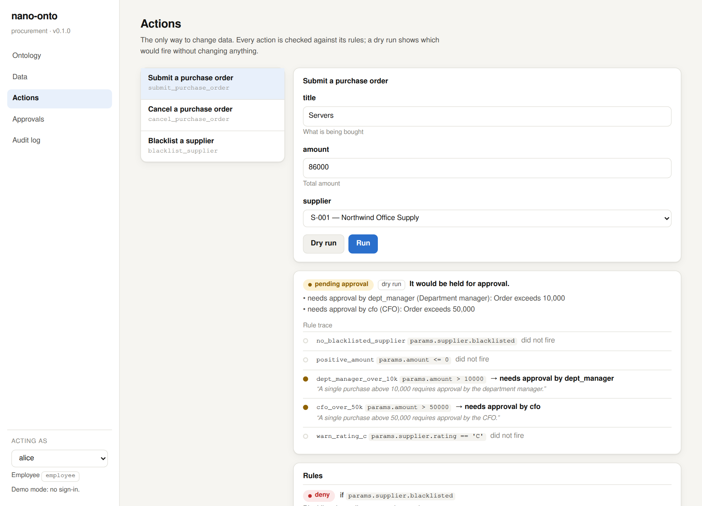
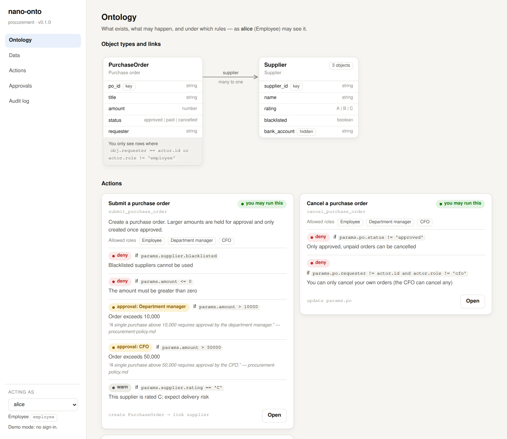
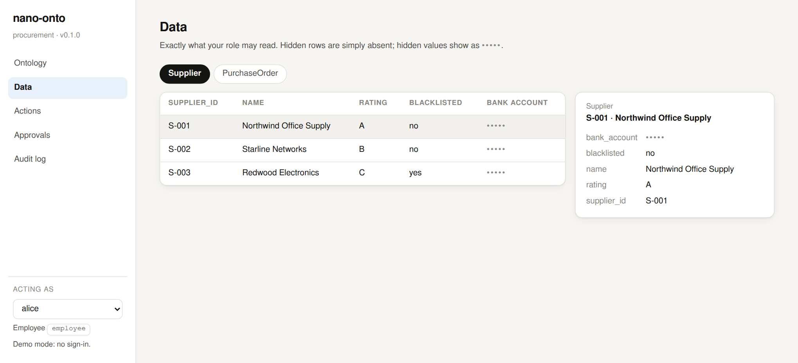
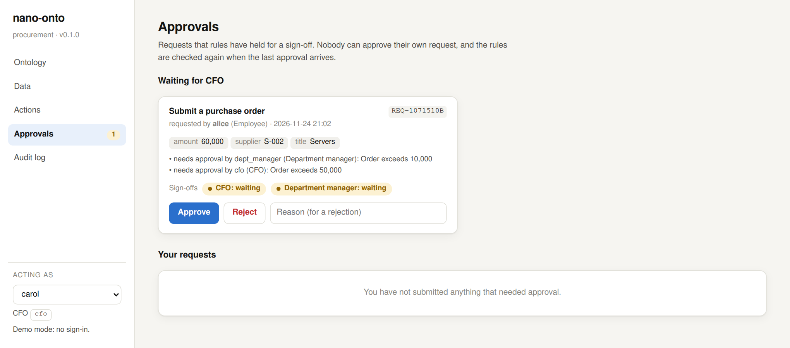
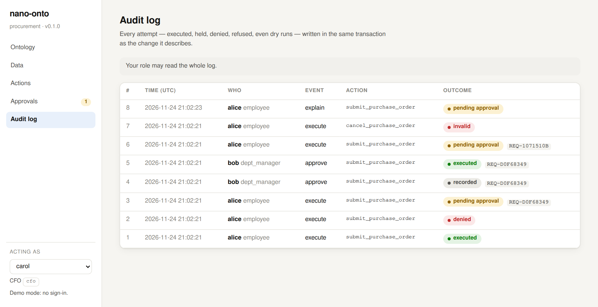

# Console

Agents reach nano-onto over MCP. People get a web console on the same engine: the ontology drawn out, the data their role may see, a form for every action, an approvals inbox and the audit log.

<p align="center">
  <picture>
    <source media="(prefers-color-scheme: dark)" srcset="../images/console-action-dark.png">
    
  </picture>
</p>

It is one static HTML page and a small JSON API, served by the standard library: no frontend build, no extra dependency, no external resources.

## Start it

Try it locally, with a user switcher instead of a sign-in:

```bash
export NANO_ONTO_SCHEMA=examples/procurement/ontology.yaml NANO_ONTO_DB=shop.db
nano-onto init --seed examples/procurement/seed.json
nano-onto console --demo alice:employee --demo bob:dept_manager --demo carol:cfo --auditor cfo
# open http://127.0.0.1:8787
```

For real use, give each person a token; the token decides who they act as:

```bash
nano-onto token --tokens tokens.yaml --actor carol --role cfo      # prints the token once
nano-onto console --tokens tokens.yaml --auditor cfo
```

| Flag | Meaning |
|---|---|
| `--tokens FILE` | The tokens file written by `nano-onto token` (shared with `serve-http`). Revoking a token takes effect without a restart. |
| `--demo USER:ROLE` | A demo user (repeatable). The page shows a switcher and nobody signs in. Only allowed when binding to localhost. |
| `--auditor ROLE` | A role that may read the whole audit log (repeatable). Everyone else sees only their own entries. |
| `--host`, `--port` | Where to listen. Default `127.0.0.1:8787`. |

## What is in it

**Ontology.** Object types and their links, with the properties hidden from your role marked and row filters spelled out. Below them, every action: who may run it, each rule with its condition, its message and the source it quotes, and the effects it has.

<p align="center">
  <picture>
    <source media="(prefers-color-scheme: dark)" srcset="../images/console-ontology-dark.png">
    
  </picture>
</p>

**Data.** Tables of the objects your role may read. Hidden rows are simply absent and hidden values are masked; select a row to follow its links.

<p align="center">
  <picture>
    <source media="(prefers-color-scheme: dark)" srcset="../images/console-data-dark.png">
    
  </picture>
</p>

**Actions.** A form generated from each action's parameters; object references are pickers that list only what you may see. *Dry run* evaluates the rules and shows the trace without changing anything; *Run* does it for real. The result says plainly whether the change happened, is held for approval, or was denied.

**Approvals.** Requests waiting for your role, with their parameters, the rules that held them and the sign-offs so far; approve or reject with a reason. Your own requests are listed with their status, never in your own inbox.

<p align="center">
  <picture>
    <source media="(prefers-color-scheme: dark)" srcset="../images/console-approvals-dark.png">
    
  </picture>
</p>

**Audit log.** Every attempt, newest first; click a row for its parameters and messages.

<p align="center">
  <picture>
    <source media="(prefers-color-scheme: dark)" srcset="../images/console-audit-dark.png">
    
  </picture>
</p>

## What it can and cannot do

The console has no powers of its own. Every request goes through the engine as the signed-in user, so:

- it shows only what `onto_query` and `onto_get` would show that user;
- an action is refused, held or executed exactly as it would be for an agent with the same identity;
- nobody can approve their own request from here either;
- everything done in the console is in the audit log, including dry runs.

Things to know before exposing it:

- **`--demo` is not authentication.** The browser says who it is. It is for trying things out and for screenshots, which is why it only binds to localhost.
- **Tokens are bearer tokens.** They are kept in the browser's session storage and sent with each request. Serve the console over TLS (put a reverse proxy in front) if it leaves your machine.
- Requests must be JSON and come from the same origin; the page loads nothing from other sites.
- The audit log has no role concept in the ontology, so who may read all of it is a deployment choice (`--auditor`).

## API

The page uses these endpoints, which you can call yourself with the same `Authorization: Bearer <token>` header:

| Endpoint | Returns |
|---|---|
| `GET /api/session` | Ontology name and version, and whether the console is in token or demo mode |
| `GET /api/me` | The signed-in user, role and whether they are an auditor |
| `GET /api/ontology` | Types, links, roles and actions (with rules) as this user may see them |
| `GET /api/objects?type=T` · `GET /api/object?type=T&id=ID` | Objects, with read permissions applied |
| `POST /api/explain` · `POST /api/run` `{action, params}` | A dry run / an execution; the same result object the MCP tools return |
| `GET /api/approvals` | `inbox` (waiting for your role), `mine` (your requests) |
| `POST /api/approve` `{request_id, note}` · `POST /api/reject` `{request_id, reason}` | The decision's result |
| `GET /api/audit` | `scope` (`all` or `own`) and the rows |

Regenerate the screenshots on this page with `python scripts/console_screenshots.py` (needs Playwright and a Chromium).
